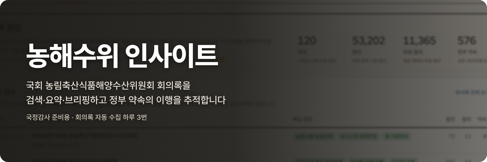
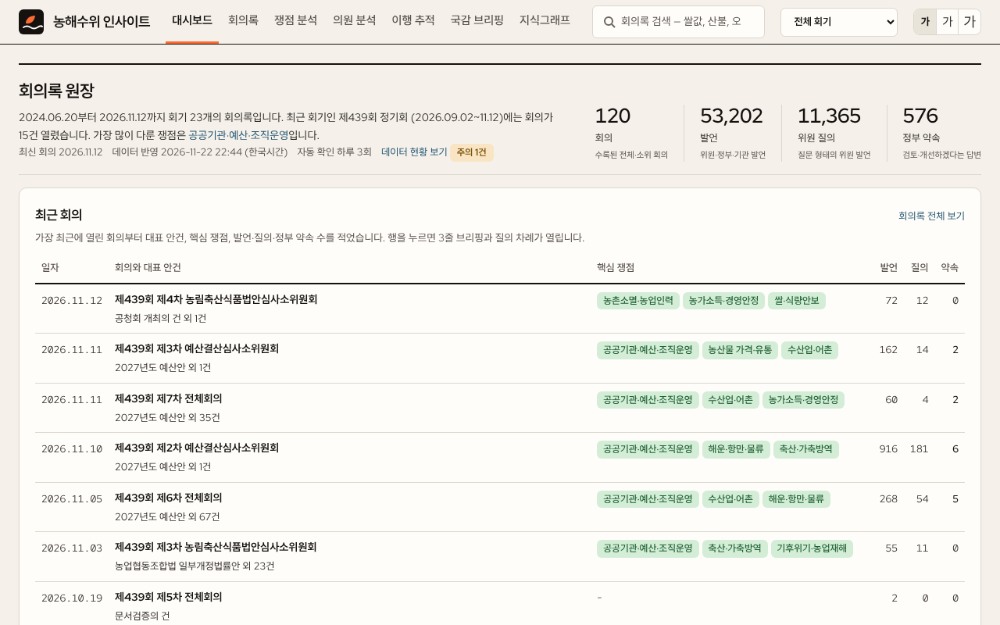
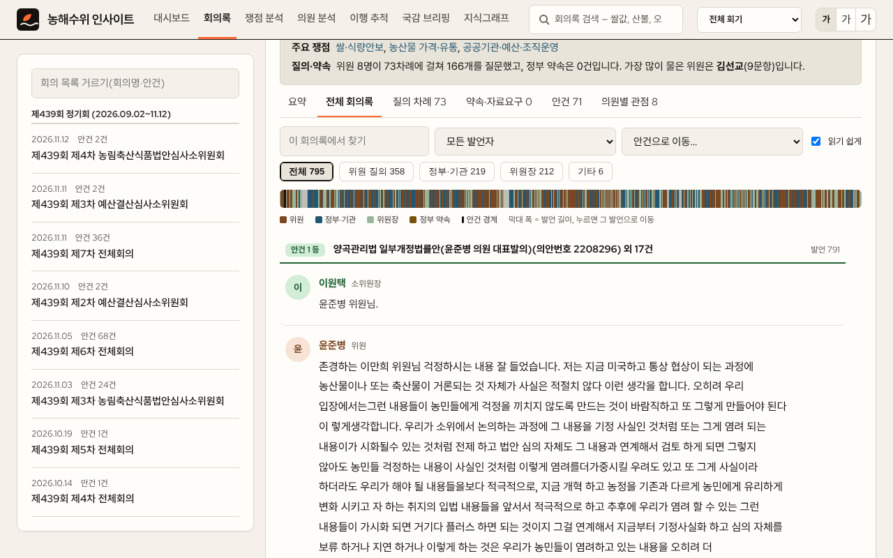
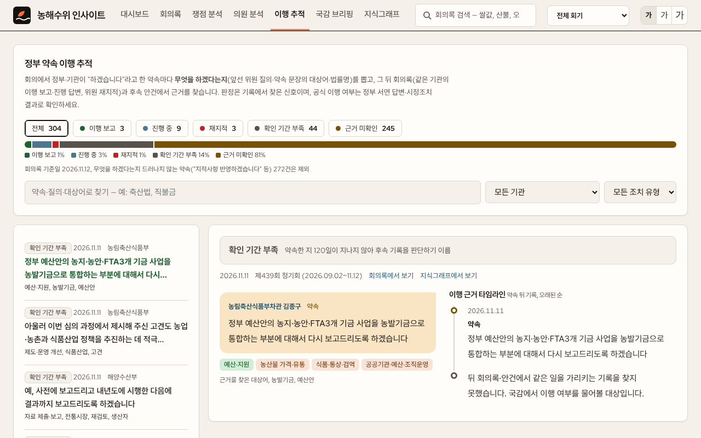
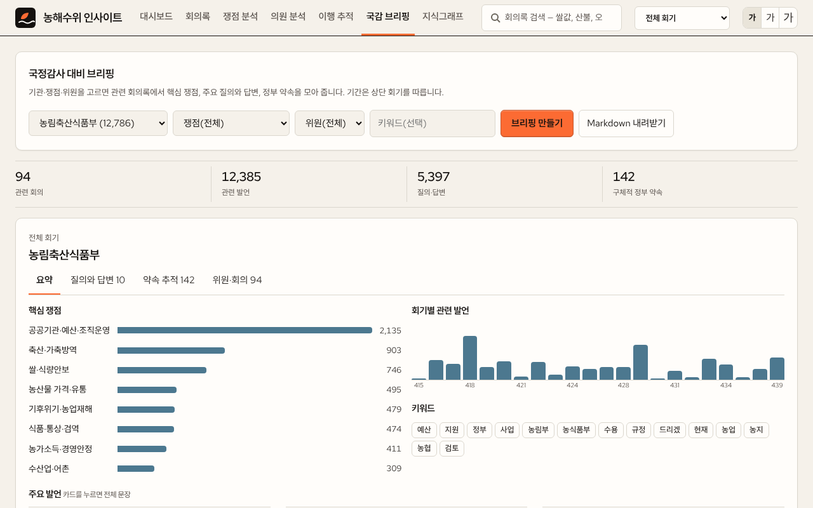

<p align="center">
  <a href="https://ax-rosy-seven.vercel.app/"></a>
</p>

<h1 align="center">농해수위 인사이트</h1>

<p align="center">
  <b>국회 농해수위 회의록을 검색·요약하고 정부 약속의 이행을 추적하는 웹 서비스</b><br>
  회의록을 발언 단위로 나눠 검색하고, 회의·쟁점·위원·기관별로 요약하고, 정부가 "하겠습니다"라고 한 약속이 뒤에 지켜졌는지 추적합니다.
</p>

<p align="center">
  <a href="https://ax-rosy-seven.vercel.app/"></a>
  <a href="https://github.com/kimjs3176-prog/AgriSea-Audit-Ontology/actions/workflows/test.yml"></a>
  <a href="https://github.com/kimjs3176-prog/AgriSea-Audit-Ontology/actions/workflows/refresh-data.yml"></a>
  <a href="https://www.python.org/downloads/release/python-3120/"></a>
  <a href="https://github.com/kimjs3176-prog/AgriSea-Audit-Ontology/commits/main"></a>
</p>

<p align="center">
  <a href="#화면-둘러보기">화면</a> ·
  <a href="#빠르게-시작하기">빠르게 시작하기</a> ·
  <a href="#명령줄로-쓰기">명령줄</a> ·
  <a href="#데이터와-자동-갱신">데이터</a> ·
  <a href="#지식그래프와-추론">지식그래프</a> ·
  <a href="#한계">한계</a> ·
  <a href="#개발">개발</a>
</p>

---

## 무엇을 하나요

국회 **농림축산식품해양수산위원회**(농해수위) 회의록 PDF를 회의 일정에 맞춰 자동으로 모아 발언 단위로 나누고, 회의·안건·발언·위원·피감기관·쟁점·정부 약속을 잇는 지식그래프로 정리합니다. 다음 같은 질문에 바로 답을 얻는 것이 목표입니다.

- 이 기관에 그동안 어떤 질의가 있었고 무엇이라고 답했나?
- 이 위원은 어떤 쟁점을 주로 묻고, 어떤 약속을 받아 냈나?
- 정부가 "검토하겠습니다", "보고드리겠습니다"라고 한 약속은 뒤 회의록에서 이행 보고됐나, 다시 지적됐나?
- 한 쟁점이 회기마다 얼마나, 누구에게서 나왔나?

> [!NOTE]
> 요약, 질의·답변 짝, 약속 판별, 이행 판정은 모두 규칙 기반 자동 분석입니다. 판정은 기록에서 찾은 신호일 뿐 공식 이행 여부가 아니므로, 보고서에 쓸 때는 화면의 원문 발언과 회의록 PDF로 확인하세요.

## 화면 둘러보기

<table>
  <tr>
    <td width="50%"><a href="docs/images/dashboard.png"></a><br><b>대시보드</b> · 수록 범위, 핵심 수치, 최근 회의와 핵심 쟁점</td>
    <td width="50%"><a href="docs/images/minutes.png"></a><br><b>회의록</b> · 발언 흐름 막대, 안건별 머리줄(「…외 17건」처럼 일괄 상정 묶음 표시)</td>
  </tr>
  <tr>
    <td width="50%"><a href="docs/images/followups.png"></a><br><b>이행 추적</b> · 약속마다 판정과 뒤 회의록에서 찾은 근거 타임라인</td>
    <td width="50%"><a href="docs/images/briefing.png"></a><br><b>국감 브리핑</b> · 기관·쟁점·위원을 고르면 핵심 쟁점, 질의와 답변, 약속 추적표</td>
  </tr>
</table>

<details>
<summary><b>화면별 쓰는 법</b> (7개 화면)</summary>

| 화면 | 이렇게 씁니다 |
|---|---|
| 대시보드 | 회기별 쟁점 흐름, 위원→쟁점→기관 관계, 최근 회의와 정부 약속을 한눈에 봅니다. **데이터 현황**(`#/data`)에서 수록 기간, 월별 회의 수, 빠진 데이터, 개념 검증에서 채워지지 않은 관계를 확인합니다. |
| 회의록 | 상단 검색으로 발언을 찾고, 회의를 골라 요약·전체 회의록·질의 차례·약속·안건을 봅니다. 발언 흐름 막대를 누르면 그 발언으로 이동합니다. 「읽기 쉽게」를 켜면 끊긴 낱말을 잇고 약칭을 풀어 줍니다. |
| 쟁점 분석 | 쟁점을 고르면 회기별 추이, 질의한 위원과 기관, 질의와 정부 답변을 봅니다. |
| 의원 분석 | 의원별 관심 쟁점, 질의 관점, 받아 낸 약속, 예상 질문을 봅니다. |
| 이행 추적 | 정부 약속마다 뒤 회의록·안건·법률안에서 찾은 근거로 **이행 보고 / 진행 중 / 재지적 / 확인 기간 부족 / 근거 미확인**을 판정합니다. |
| 국감 브리핑 | 기관·쟁점·위원·키워드를 골라 핵심 쟁점, 주요 질의와 답변, 약속 추적표를 만들고 Markdown으로 내려받습니다. |
| 지식그래프 | 개체(쟁점·기관·의원·의안·약속)를 찾아 관계를 따라 이동하고, 클래스 계층·추론 규칙·개념 검증 결과를 보고, SPARQL로 직접 질의합니다. 점선 테두리는 추론으로 도출된 관계입니다. |

</details>

> [!TIP]
> 화면 위의 회기 선택으로 범위를 좁힐 수 있고, 주소(`#/meetings/회의ID`, `#/issues/쟁점ID`, `#/brief`, `#/data`, `#/kg`)로 지금 보는 화면을 공유할 수 있습니다. 머리글의 「가 가 가」로 본문 글자 크기를 고르면 이 브라우저에 기억됩니다.

## 빠르게 시작하기

**필요한 것:** Python 3.12, Git. 인증키 없이도 저장소에 들어 있는 초기 데이터(`data/seed.sqlite3.gz`, 22대 국회 농해수위 회의록)로 바로 실행됩니다.

```bash
git clone https://github.com/kimjs3176-prog/AgriSea-Audit-Ontology.git
```

```bash
cd AgriSea-Audit-Ontology
```

```bash
pip install -r requirements.txt
```

```bash
python -m agrisea serve --port 8000
```

브라우저에서 http://127.0.0.1:8000 을 엽니다. 처음 실행할 때 초기 데이터를 `var/`에 풀어 쓰므로, 대시보드에 회의 수·발언 수·위원 질의·정부 약속 수가 바로 나오면 정상입니다.

새 회의록을 직접 모으려면 [열린국회정보](https://open.assembly.go.kr) 인증키가 필요합니다.

```bash
cp .env.example .env
```

`.env`의 `ASSEMBLY_API_KEY`에 인증키를 넣은 뒤, 최근 14일 회의록과 본문을 내려받습니다.

```bash
python -m agrisea collect --dae 22 --days 14 --fetch
```

## 명령줄로 쓰기

웹 화면과 같은 기능을 명령줄에서도 씁니다. 서버를 한 번 띄워 초기 데이터를 푼 뒤(또는 `collect`로 모은 뒤) 실행하세요.

```bash
python -m agrisea search 쌀값 --limit 3
```

```text
[2025-01-09] 위원 윤준병: 윤준병입니다. 작금의 사태에 대해서 …
```

```bash
python -m agrisea briefing --org 해양수산부 -o 해양수산부-브리핑.md
```

```text
저장: 해양수산부-브리핑.md
```

| 명령 | 하는 일 |
|---|---|
| `stats` | 수록 현황(회의·발언·질의·약속 수, 기간) |
| `search 검색어 [--limit N]` | 발언 전문 검색 |
| `summary 회의ID [--llm]` | 회의 요약(`--llm`은 `ANTHROPIC_API_KEY` 필요) |
| `briefing [--org] [--issue] [--member] [--keyword] [--from] [--to] -o 파일.md` | 국정감사 대비 브리핑 Markdown |
| `sparql "질의"` | 지식그래프 SPARQL 질의 |
| `validate` | 지식그래프가 스키마의 개념 정의를 지키는지 점검(111개 항목) |
| `collect`, `fetch-minutes`, `programs` | 회의록 목록·본문, 지원사업 공고 수집 |

## 데이터와 자동 갱신

| 데이터 | 출처 |
|---|---|
| 위원회 회의록 | 열린국회정보 「위원회 회의록」 API + 국회 회의록 PDF |
| 법률안 처리 현황 | 열린국회정보 「국회의원 발의법률안」 API |
| 지원사업 공고 | 공공데이터포털 「창업진흥원 K-Startup 조회서비스」(농림·해양수산 관련 공고만, 이행 근거로 사용) |

- **회의록 데이터 갱신**(GitHub Actions): 실제 회의 일정에 맞춰 돌립니다. 농해수위 회의는 평일(주로 화·수·목)에 열리고 회의록은 회의 4~10일 뒤에 올라오므로, 평일 하루 3번(09:47·13:17·18:47 KST)과 주말 하루 1번(11:17 KST) 수집합니다. 마지막 회의가 21일 넘게 지난 휴회 중에는 평일 아침 1번만 수집합니다. 매번 오늘 21일 전부터 다시 조회해 늦게 올라온 회의록도 놓치지 않습니다. 새 회의록과 공고를 모아 분석한 뒤 `data/`에 커밋하면 Vercel이 다시 배포합니다. 국회 PDF나 공공데이터포털이 해외 접속을 막으면 서울 리전 배포본(`/api/minutes-text`, `/api/kstartup`)을 거쳐 받습니다. 실행이 실패하면 「회의록 자동 수집 실패」 이슈가 열립니다.
- **Vercel 용량**: 작업 브랜치(`claude/**`)와 `governance-log`는 미리보기 배포를 만들지 않습니다(`vercel.json`). 지난 배포본이 쌓여 무료 용량(10GB)을 넘지 않도록 Vercel 프로젝트 Settings → Security → Deployment Retention Policy에서 보관 기간을 짧게 두고, 넘었으면 `vercel remove <프로젝트> --safe --yes`로 별칭 없는 배포를 지웁니다.
- **GitLab 미러**(GitHub Actions): `main`을 기관 GitLab으로 푸시합니다. 기관 GitLab은 해외에서 접속되지 않아 국내 PC의 self-hosted 러너나 PC 예약 스크립트로 실행합니다. 설정은 [docs/gitlab-mirror.md](docs/gitlab-mirror.md)를 보세요.

| 설정 | 어디에 | 용도 |
|---|---|---|
| `ASSEMBLY_API_KEY` | Vercel 환경 변수, GitHub Actions Secrets | 열린국회정보 인증키(수집에 필수) |
| `KSTARTUP_API_KEY` | Vercel 환경 변수, GitHub Actions Secrets | 공공데이터포털 인증키(지원사업 공고) |
| `ANTHROPIC_API_KEY` | Vercel 환경 변수 | 선택: Claude 회의 요약. 배포 용량을 아끼려고 `anthropic` 패키지는 기본 설치에서 뺐으니, 쓰려면 `requirements-llm.txt`의 패키지를 `requirements.txt`에 다시 넣는다 |

> [!IMPORTANT]
> 인증키는 `.env`(로컬)나 각 서비스의 비밀 설정에만 넣고 저장소에 커밋하지 마세요. `.env`는 `.env.example`을 복사해 만듭니다.

## 지식그래프와 추론

회의록에서 뽑은 사실을 RDF 지식그래프로 만들어, 화면의 관계 탐색과 SPARQL 질의, 이행 판정의 근거로 씁니다.

<details>
<summary><b>스키마, 추론 규칙, 개념 검증 자세히</b></summary>

- **스키마**(`ontology/agrisea.ttl`, v0.5): 회의·안건·의안(정부 제출/의원 발의/위원회 대안)·발언(질의/답변/약속/자료요구)·인물·기관·쟁점·지원사업·이행 근거.
  한꺼번에 상정한 안건 묶음은 각 안건을 발언이 붙는 대표 안건(묶음 끝 안건)에 「함께 상정된 안건」(`ag:jointlyTakenUpWith`)으로 잇습니다.
  질의는 기관을 향한 질의 외에 회의 진행 질의(위원장·전문위원에게 묻는 발언 시간·의사 진행 등), 진술인·참고인 질의, 위원 간 논의 질의(법안 심사에서 위원끼리 주고받은 질의)로 나누고, 이 셋은 기관 대신 질의 대상 인물로 잇습니다.
  대상 기관을 못 찾은 질의는 같은 위원의 같은 질의 차례가 한 기관을 향했으면 그 기관을 추정 질의 대상 기관으로 따로 잇습니다.
  역관계, 하위 관계, 대칭 관계, 관계 연쇄, 정의 클래스 같은 OWL 공리와 쟁점 분류·이행 판정·조치 유형 SKOS 개념체계를 담습니다.
- **추론기**(`agrisea/reasoner.py`): 스키마 규칙 6개와 업무 규칙 9개(의원이 질의한 쟁점·기관, 기관이 답변·약속한 쟁점, 함께 논의된 쟁점, 쟁점의 지원사업, 국감 확인 대상 약속 등)를 더 나올 사실이 없을 때까지 반복 적용합니다. 추론한 사실은 규칙별 이름 있는 그래프(`…/id/graph/inferred/규칙ID`)에도 기록해 출처를 추적합니다.
- **개념 검증**(`agrisea/validate.py`, 지식그래프 탭 「개념 검증」, `python -m agrisea validate`): 111개 항목을 점검합니다. 오류는 공리 위반(배타 클래스, 값이 하나여야 하는 관계, 정의역·치역·자료형 위반, 스키마에 없는 용어 등), 경고는 개념상 있어야 할 관계가 빠진 것, 참고는 동명이인처럼 사람이 확인할 것입니다. OWL은 열린 세계 가정이라 SHACL처럼 닫힌 세계로 점검합니다.
- **저장**: 자동 갱신 때 추론까지 마친 그래프를 `data/kg.nq.gz`(N-Quads)로 저장하고, 서버는 이를 불러와 바로 질의합니다.
- **API**: `/api/ontology/summary`, `/api/ontology/entity?iri=`, `/api/ontology/instances?cls=`, `/api/ontology/search?q=`, `/api/ontology/validation`, `/api/sparql`, `/api/data-status`.

</details>

## 한계

이 서비스가 하지 **않는** 것과 알려진 약점입니다.

- **공식 기록을 대신하지 않습니다.** 판정과 요약은 규칙 기반 자동 분석이라 놓치거나 잘못 잡는 경우가 있습니다.
- **국정감사 회의록 일부가 빠져 있습니다.** 열린국회정보 API로 받을 수 없는 회의는 대시보드의 데이터 현황(`#/data`)에 빠진 데이터로 표시됩니다.
- **PDF 추출 잡음이 조금 남습니다.** 띄어쓰기가 깨진 원문은 자동 교정하지만 완벽하지 않고, 표지·목차 조각이 첫 발언에 남은 회의가 드물게 있습니다.
- **농해수위만 다룹니다.** 다른 위원회 회의록은 기본 수집 대상이 아닙니다(`collect --all-committees`로 저장만 할 수 있습니다).

## 개발

```bash
pip install -r requirements-dev.txt
```

```bash
python -m pytest -q
```

PR과 `main`의 코드 변경마다 GitHub Actions 「테스트」가 같은 명령을 실행합니다.

- 코드 구조: 수집 `agrisea/pipeline.py` · 회의록 파싱 `agrisea/parser.py` · 저장 `agrisea/store.py` · 분석 `agrisea/analysis.py`, `followup.py`, `members.py` · 지식그래프 `agrisea/ontology.py`, `reasoner.py`, `validate.py` · 웹 `agrisea/web/`
- 분석 규칙이나 저장 형식을 바꾸면 `agrisea/precompute.py`의 `PRECOMPUTE_VERSION`을 올립니다. 다음 자동 갱신이 초기 데이터를 다시 계산합니다.
- 파서 개선을 기존 데이터에 반영할 때는 회의록 텍스트를 다시 읽는 `scripts/fix_agenda_groups.py`를 씁니다(여러 번 돌려도 결과가 같음).

## 라이선스

아직 라이선스 파일이 없습니다. 코드를 재사용하려면 저장소 소유자에게 먼저 문의하세요. 회의록 원문과 공고 데이터의 이용 조건은 각 출처(열린국회정보, 공공데이터포털)의 약관을 따릅니다.
